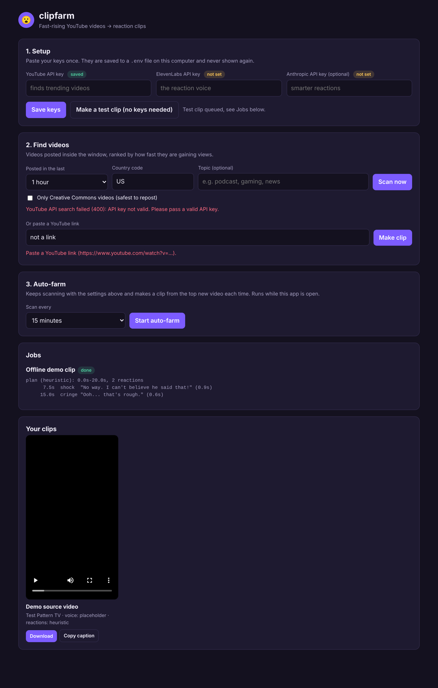

# clipfarm

Turns your own GTA gameplay recordings into commentated vertical shorts
(1080x1920). Upload a recording and the app finds the best moments, has Claude
write commentary about what actually happens on screen, voices it with
ElevenLabs, and adds shorts-style captions.

It can also make reaction clips from fast-rising YouTube videos (section 3 in
the app), but only use videos you have permission to repost.

## Start the app

Needs Python 3.10+ and `ffmpeg` on your PATH.

```bash
pip install -e .
clipfarm app            # then open http://127.0.0.1:8000
```



Everything happens in the browser:

1. **Setup** — paste your API keys (saved to `.env` on your computer), or click
   **Make a test clip** to try it with no keys at all.
2. **GTA shorts** — upload recordings, pick a commentary style (hype,
   funny, or story narration) and a layout (full-screen gameplay with
   captions, or the cartoon character on top), then click **Make shorts**.
   No recordings yet? Click **Use test footage** to try it.
3. **React to YouTube videos** — scan for videos posted in the last 10 minutes
   to 24 hours, then click **Make clip**, or paste a YouTube link.
4. **Auto-farm YouTube** — keeps scanning on a timer and clips the top new video.

Finished clips appear at the bottom to watch, download, and copy a caption.

If a clip fails with **"Sign in to confirm you're not a bot"**, pick the
browser you're signed in to YouTube with under **Setup → YouTube sign-in** and
save. The app then borrows that browser's YouTube cookies for downloads. On a
Mac, Chrome asks for your keychain password the first time, and Safari needs
the Terminal app to have Full Disk Access (System Settings → Privacy &
Security).

| Key | Used for | Without it |
| --- | --- | --- |
| `YOUTUBE_API_KEY` | finding new, fast-rising videos | `discover`, `run`, `watch` do not work; `make <url>` still does |
| `ELEVENLABS_API_KEY` | the reaction voice | a placeholder blip is used instead of speech |
| `ANTHROPIC_API_KEY` | Claude reads the transcript, picks the moment and writes reactions to what was said | keyword heuristic and canned lines ("Oh my god!", "Wait, WHAT?!") |

## Command line

The same pipeline without the browser:

```bash
clipfarm discover --window 60          # fastest risers posted in the last hour
clipfarm discover --window 10 --query "podcast"
clipfarm make https://www.youtube.com/watch?v=VIDEO_ID
clipfarm run --window 60 --count 3     # discover + make the top 3 new ones
clipfarm watch --interval 15           # keep scanning every 15 minutes
```

Each clip lands in `output/<video id>/`:

- `final.mp4` — the finished short
- `meta.json` — suggested title, source link and credit line, reaction timings

`output/seen.json` remembers which videos were already processed.

## How it works

**Discovery** (`discover.py`). One `search.list` call for videos published
inside the window, one `videos.list` call for statistics. Videos are ranked by
engagement per minute since upload: `(views + 20·likes + 50·comments) / age`.
Each scan costs about 101 quota units out of YouTube's default 10,000 per day,
so scanning every 15 minutes is fine and scanning every minute is not.
YouTube's search index also lags by a few minutes, so a `--window` under about
10 usually returns very little.

**Planning** (`moments.py`). With Anthropic credentials, Claude gets the
timestamped captions and returns the clip range plus 2–4 reactions, each tied
to the line it reacts to. Otherwise the heuristic uses YouTube's
"most replayed" data when it exists, or the stretch of captions with the most
charged words, and picks canned lines by emotion.

**Voice** (`voice.py`). Each reaction goes to ElevenLabs text-to-speech. With
the default `eleven_v3` model the line is prefixed with an audio tag
(`[gasps]`, `[laughs]`, ...) so it is performed rather than read. Reactions are
rescheduled so they never talk over each other, and the source audio ducks
under the voice.

**Character** (`character.py`). An original blob drawn with Pillow, with four
reaction poses (gasp, shock, laugh, cringe) plus idle breathing and blinking.
The mouth follows the loudness of the voice track, so it moves in time with
the speech. Rename it with `CLIPFARM_CHARACTER_NAME`.

## Monetization

YouTube pays for original content. Your own gameplay plus commentary about
what happens in it qualifies; reposting other people's clips (even with the
facecam cropped out) does not, and can bring copyright claims. As far as we
know, Rockstar allows monetizing GTA gameplay videos.

Add an Anthropic key: without it the commentary falls back to a few generic
template lines, which are fine for testing but are exactly the kind of
repetitive content YouTube's monetization review rejects.

From the command line: `clipfarm gta recording.mp4 --count 3 --style story`.

## Before you post YouTube reaction clips

Clips made from other people's videos are their content. Short commentary
clips are common, but they can still draw copyright claims or strikes, and
downloading from YouTube is against its terms of service. To stay on the safe
side: use `--creative-commons` to only pick CC-licensed videos, clip channels
that allow it, and keep the credit (it is drawn on the clip and written to
`meta.json`).

## Tests

```bash
pip install -e ".[dev]"
pytest
```
